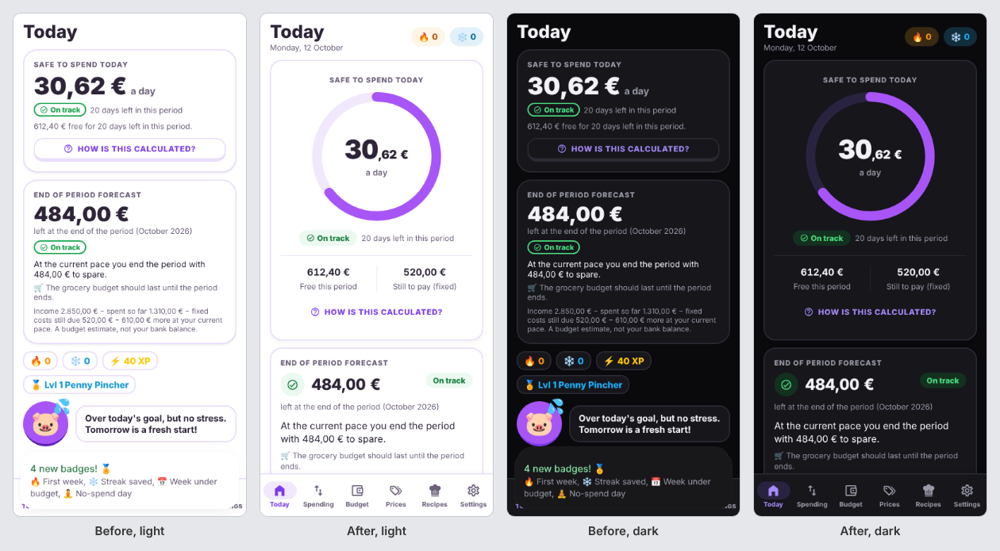
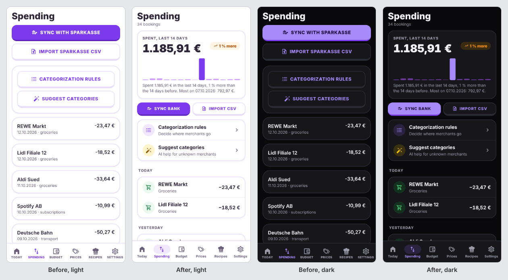
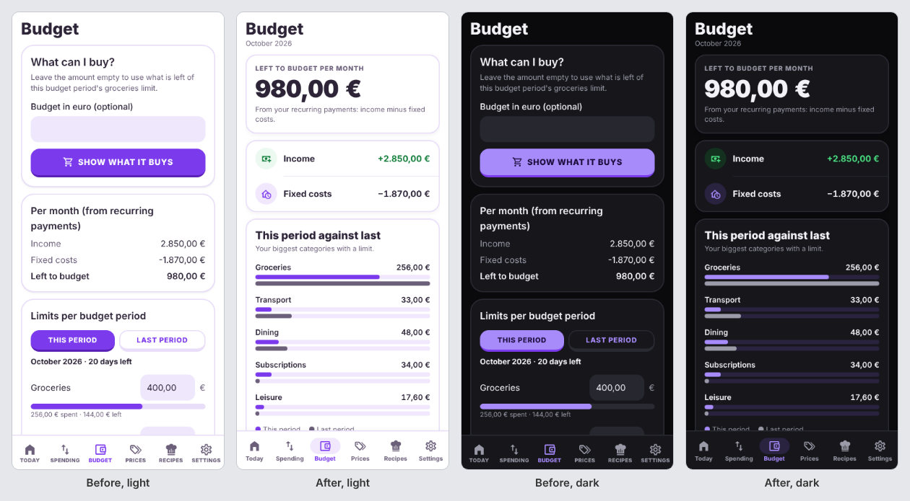
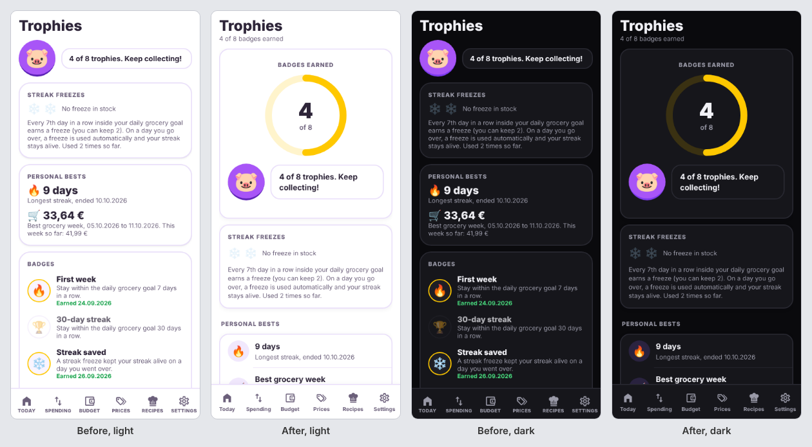
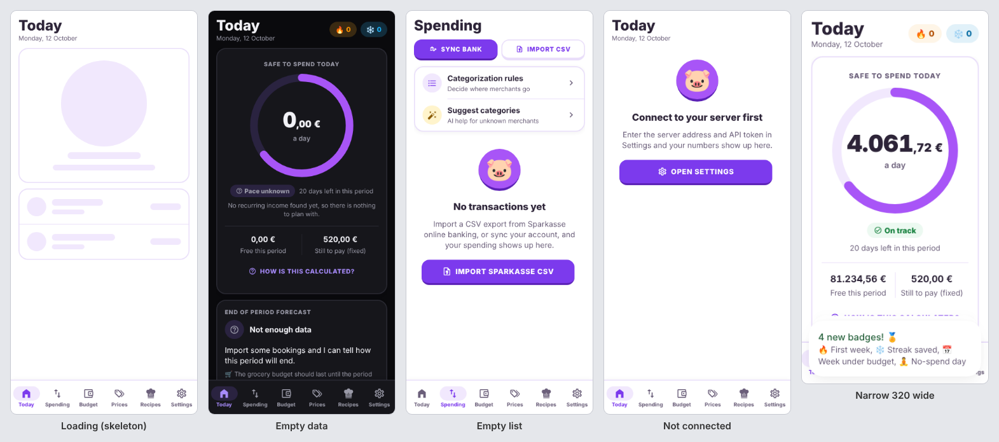

# UI design

The app has a calm, dashboard-style look: an indigo accent on cool grey-blue neutrals, flat sections closed by hairlines (no boxed cards), flat buttons with 8-12 point corners, sentence-case labels, the pig mascot and a real dark theme. This
page describes the system behind it so new screens look like the old ones. The code lives in
`apps/mobile/src`.

## Design watch

Two things keep the look from drifting.

- **The design guard** (`apps/mobile/tests/designGuard.test.mjs`, part of `npm test`, so part of CI) fails when a change breaks a rule the look depends on: hex colours outside the palette, tracked capitals, borders thicker than a hairline, a 3D button lip, text under 12 points, emoji used as interface icons, a screen without the shared `Screen` and `Title`. Each rule lists its few deliberate exceptions; add to a list only for content that really is an exception (the mascot, the camera frame).
- **The gallery and the change report.** Run the Native workflow with `screenshots` ticked: it opens every screen on an Android emulator, light and dark, publishes the pictures and a browsable `README.md` to the `ci-screenshots` branch, and puts a table in the run summary that says how much of each screen changed since the previous run. A screen above 12% is marked **check**: that is usually a layout change that was or was not meant. `.github/scripts/design-gallery.sh` builds both.

## Navigation

Three tabs: **Today**, **Money** (Spending and Budget) and **Groceries** (Prices, Recipes, Meal plan, Usual items). **Settings** is a gear button at the top right of every everyday screen. Settings and the screens opened from it (Sync, Rules, Subscriptions, Alerts, Receipts, Receipt sources, Scan) are a separate area: no tab bar, a back button at the left of the title and a faintly grey page in the light theme. Screens that share a tab have a switcher under the title (`SectionSwitch`). The map is in `src/navigation.ts` and `tests/navigation.test.ts` fails when a screen is in neither a tab nor the settings area. The bar itself is `AppTabBar`, drawn by the app because the stock tab bar cannot keep a tab selected on routes it does not list; `Title` adds the gear or the back button by looking at the current path.

## Where the ideas come from (and what was not checked)

The Mobbin reference library was **not available** while this was built (it needs a paid plan), so
none of the patterns below were copied from or compared against specific Mobbin screens. They come
from patterns that are common in budgeting and habit apps: one hero number per screen with a
progress ring (the "safe to spend" idea), secondary figures as grouped list rows with a leading
icon, a trailing value and a chevron, skeletons instead of spinners, an empty state with a
character and one action. If you have Mobbin access, compare Today, Spending and Budget with
budgeting apps there and adjust; the tokens below make that a small change.

Nothing here was run on a phone. It was built as a web export and looked at in a 390 x 844 browser
window in light and dark (see `docs/ui/`). Haptics, the safe-area inset on a device with a home
indicator, native text scaling and the system reduce-motion switch are written to the platform
APIs but unchecked on hardware.

## Tokens

All in `src/tokens.ts` (numbers) and `src/colors.ts` (palette); `src/theme.ts` re-exports them and
adds `usePalette()`. They are plain data with no React Native import, so tests can check them.

| Token | Values |
|---|---|
| `space` | `xs 4`, `sm 8`, `md 12`, `lg 16`, `xl 24`, `xxl 32`, `huge 48` (4/8 grid) |
| `radius` | `sm 8`, `md 12`, `lg 16` (buttons), `xl 20` (cards), `pill 999` |
| `typography` | `display 44/50` (one hero number), `title 28/34`, `heading 20/26`, `body 16/22`, `bodyStrong`, `label 14/20`, `caption 13/18`, `overline 12/16` (upper case, letter-spaced) |
| `tabular` | spread into a text style for amounts so digits line up |
| `elevation` | `none`, `card` (hairline border plus a faint shadow), `raised` (tab bar), `overlay` (sheets) |
| `motion` | `press 90`, `quick 180`, `base 280`, `progress 700`, `countUp 900` ms |

Rules of thumb: spacing and radius come from the tokens, not loose numbers; text is never smaller
than 12; cards use `radius.xl`, buttons `radius.lg`, badges and pills `radius.pill`.

### Colour roles

`palette.light` / `palette.dark` (`src/colors.ts`). `global.css` mirrors the ones HeroUI reads
(`--success`, `--danger`, `--accent`, ...); keep both in step.

- Text on surfaces: `text`, `muted`, and the coloured text roles `accent`, `good`, `bad`, `warn`,
  `blue`, `goldText`. Every one of them is at least 4.5:1 on `background`, `surface`, `surfaceAlt`
  and on its own `*Soft` tint.
- Decorative only (rings, fills, medals), never text: `fill`, `orange`, `gold`.
- Button labels: `onAccent` on `accent`, `onBlue` on `blue`, `onBad` on `bad` (4.5:1 as well).
- `*Soft` colours are pale backgrounds for badges, pills and icon circles.
- Income is `good` (green), spending stays in `text` (a screen full of red is noise); red is for
  "over" and errors.

## Components

Shared, in `src/components`. Screens import these instead of hand-building rows and cards.

| Component | Use |
|---|---|
| `ui.tsx`: `Screen`, `Title` (optional `subtitle`, `right`), `Card` (`flush`), `Bar`, `Loading` (`variant="skeleton"`), `NeedsSetup` | page frame and the basics (all older props still work) |
| `kit.tsx`: `ChunkyButton`, `Text`, `Chip`, `IconButton`, inputs | primitives on HeroUI Native; buttons are at least 44 high |
| `Money` | an amount: German notation, real minus, non-breaking space before the euro sign, tabular digits, one line, spoken label (`minus 23,47 euros`) |
| `Ring` | progress ring on react-native-svg, animated with Reanimated; children in the middle |
| `rows.tsx`: `ListGroup`, `ListRow`, `IconBadge`, `StatusPill`, `SectionHeader`, `toneColors` | grouped lists: leading icon, title, subtitle, trailing value, chevron; rows are at least 56 high |
| `Skeleton`: `Skeleton`, `SkeletonList`, `SkeletonHero` | loading placeholders (static with reduced motion) |
| `EmptyState` | mascot, a title, one sentence, at most one action |
| `Charts`: `Sparkline`, `BarChart`, `CompareBars` | small charts on react-native-svg, each with a summary sentence |
| `Mascot` (`MascotFace`, `Mascot`) | the pig; `mood` input unchanged (see MASCOT.md) |
| `motion.ts`: `useReduceMotion`, `useCountUp` | reduced-motion switch and the Today count-up |

Pure helpers (unit-tested in `tests/`): `a11y.ts` (WCAG contrast, touch minimum), `ring.ts` (ring
geometry, dash offset, count-up easing, hero font size), `charts.ts` (spark points, bar rects,
spending trend and the sentences for it), `format.ts` (`formatMoney`, `spokenMoney`,
`splitMoney`, `dayHeading`; `formatCents` is kept), `categoryIcons.ts`.

## Patterns

- **One hero number per screen.** Today: the daily "safe to spend", on the one filled panel of the
  app (`components/today/TodayHero`). Under the number a curve shows what has been spent since the
  budget period began, continued as a dotted line to where the forecast says it ends, then the
  three figures behind the daily amount. Spending: spent in the last 14 days. Budget: left to
  budget per month. Trophies: badges earned. Everything else is a secondary row or card.
- **Every screen opens the same way.** Title, then (on tabbed screens) the underlined tab strip
  (`SectionSwitch`), then one `HeroPanel` (`components/panel.tsx`) with the number the screen is
  about: Spending (spent in 14 days, with bars), Budget (left per month, income and fixed costs),
  Stores (spent in stores), Subscriptions (monthly total), Trophies (badges earned), Recipes (how
  many match), Meal plan (days planned), Usual items (how many), Prices (best chain). Today's
  panel adds the spending curve. Settings screens are plain lists and have no panel. A new screen
  uses `HeroPanel` with `PanelFigure` or `PanelNumber`, never its own filled block; the design
  guard fails on a hand-made accent block with the panel's radius.
- **Tabs and choices are quiet.** Screens that share a tab are switched with text tabs, the open
  one in the accent colour with a line under it. Choices between a few options (period, horizon,
  segment) use `SegmentedButtons`: a hairline outline with the chosen segment in the soft tint.
  Filters are small chips. Nothing here is a big filled pill any more.
- **Chart colours** are `chart1`..`chart5` in `colors.ts` (lavender, cyan, butterscotch, orange,
  green), used in that order for donut slices and store bars; each reaches 3:1 on the page in both
  themes (`tests/theme.test.ts`). The accent stays indigo for text, buttons and the panel.
- **The shopping assistant follows the same language.** `packages/shopping` cannot import from the
  finance app (it can be built on its own), so `src/ui/theme.ts` and `src/ui/kit.tsx` repeat the
  palette, the chart colours, the `HeroPanel`, the flat `Card`, the quiet `Segmented` control and
  the soft-pill tab bar. When you change a token or one of these pieces in the finance app, change
  its twin there. Deals, Watching, Product and Compare open with a panel; Search, Plans and
  Settings stay forms and lists.
- **Filled tiles are allowed in one place.** The "This period" block on Today (Spent, Income, Still
  to pay, Left to spend) uses four tiles in the palette's soft tints, each with a small figure, a
  mini chart or bar and a round arrow to the screen behind it. Everything else stays a flat section
  with a hairline, because a page of tiles loses its order. Do not add tiles elsewhere without
  changing this rule. The tile idea comes from a mobile finance reference ("Smarter Insights");
  the tints are our own tokens, not its gradients.
- **Today in order:** the panel, the four tiles, the last seven days as bars (today strong, the average as a dotted
  line, the change against the week before), where the period's money went (donut with a legend
  that names every category and its share), the grocery goal, the forecast, the watchdog, the
  stores link, then level and quests (only the next open quest until "All quests" is tapped) and
  trophies. The numbers behind the three pictures are in `src/todayCharts.ts` (pure, tested); each
  picture has a sentence for screen readers, built from the same data.
- **Pictures never carry the information alone.** Donut slices differ by hue only to tell them
  apart; every legend row names its category. Savings transfers and income are not spending and are
  left out of all three pictures.
- **Lists are grouped.** A `ListGroup` per block (and per day in Spending), `ListRow` for each row.
  Amounts in the trailing slot with `Money`; they keep their width and the title shrinks.
- **Money.** Always through `Money` or `formatMoney` in new code. Sign and colour follow the amount.
- **States.** Loading shows skeletons shaped like the content, an empty list shows `EmptyState`
  with one action, errors show `EmptyState` with "Try again". Pull-to-refresh stays on every list
  or scroll view that loads data.
- **Motion** is restrained: button press (the face dims), the ring and bars sliding to their
  value, the Today count-up, the mascot bob, skeleton pulse. All of it is skipped with the system
  "reduce motion" setting (`useReduceMotion`).
- **Charts** use `react-native-svg` only. Pass the sentence from `charts.ts` as `summary`; it is
  the accessibility label and (with `showSummary`) visible text.

## Accessibility rules

- Text colours reach 4.5:1 in light and dark. `tests/theme.test.ts` computes the ratios for every
  text role on every surface and every tint; adding a colour means adding it there.
- Touch targets are at least 44 points (`MIN_TOUCH`): `ChunkyButton` has `minHeight` 44 (compact)
  or 52, `ListRow` 56, `IconButton` 44 x 44.
- Interactive things have a role and a label; decorative things (rings, icon badges, the mascot)
  are hidden from screen readers and their meaning is in text next to them. A ring or bar that
  carries meaning gets an `accessibilityLabel` and `progressbar` value.
- Dynamic type: no fixed heights on text, rows grow, `Money` stays on one line with `flexShrink: 0`
  and the title beside it wraps. The hero amount picks its font size from its length
  (`heroFontSize`) so it never clips, with `adjustsFontSizeToFit` as a second net on native.
- Colour is never the only cue: pills carry an icon and a word, the selected tab has a pill behind
  its icon.
- Small phones: the tab labels drop to 10 points below 360 points of width.

## How to add a screen

1. Create `src/app/<name>.tsx`; wrap the content in `Screen` and start with `Title`.
2. Load data with `useScreenData` (or your own state); show `NeedsSetup` without a server,
   skeletons while loading, `EmptyState` when there is nothing, and give the scroll view a
   `RefreshControl`.
3. Pick the one hero number and show it with `Money` (`variant="display"`, or inside a `Ring`).
4. Build the rest from `Card`, `ListGroup`/`ListRow`, `StatusPill`, `Bar`, `Charts`. Spacing and
   type from `space` and `typography`; colours from `usePalette()`.
5. Register a tab or a hidden route in `src/app/_layout.tsx`.
6. Check it in light and dark, with a long title and a large amount, and add a pure helper plus a
   test for any non-trivial logic (put the file in `tests/tsconfig.json` `include`).

## Screens changed in this pass

Today, Spending, Budget, Trophies and the tab bar. Behaviour, data flow and API calls are
unchanged; the one addition is pull-to-refresh on Today, Budget and Trophies. Before and after in light and
dark are in `docs/ui/` (`today.png`, `spending.png`, `budget.png`, `trophies.png`; `scrolled.png`
shows the lower parts; `states.png` shows loading, empty, not connected and a 320 point width).

